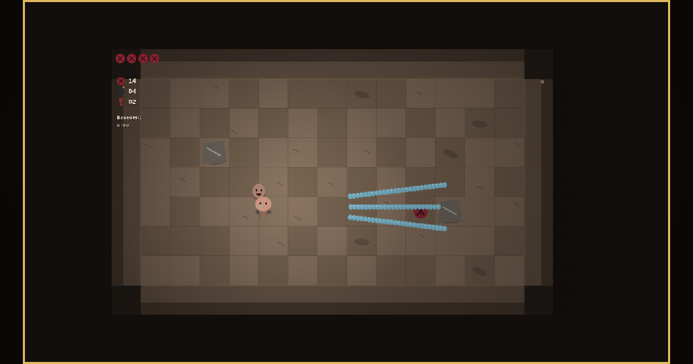

# ISUCK

ISUCK is a free, from-scratch browser roguelike inspired by *The Binding of
Isaac: Repentance*. It runs entirely in one web page: no engine, installation,
accounts, ads, sprite sheets, or downloaded audio assets.

[Play ISUCK](https://andrenijman.github.io/isuck/)



## What is in it

- 732 collectibles, 189 trinkets, 97 cards, and 50 pills
- 34 playable characters and 104 familiar behaviours
- 208 enemies, 80 bosses, 500 room templates, and 57 floors
- 45 challenges and 637 achievements
- Main, alternate, ascent, endgame, and Greed-style floor routes
- Seeded procedural runs, persistent unlocks, keyboard and gamepad input
- Canvas-drawn sprites and synthesised WebAudio sound

## Controls

| Action | Keyboard |
| --- | --- |
| Move | `W` `A` `S` `D` |
| Shoot | Arrow keys |
| Active item | `E` |
| Card or pill | `Q` |
| Swap pocket item | `Z` |
| Place bomb | `Space` |
| Map | `Tab` |
| Drop / restart | `R` |
| Pause | `Escape` |

Menus use the arrow keys, `Enter`, and `Backspace`. Controls can be rebound in
the game, and a connected gamepad is detected automatically.

## Run locally

The game has no build step. Serve the repository root with any static server:

```bash
python3 -m http.server 8080
```

Then open <http://localhost:8080>. Opening `index.html` directly also works in
current Chromium-based browsers.

## Verify the build

```bash
node tools/validate-content.mjs
node tools/smoke.mjs
node tools/balance.mjs --runs 200
```

The validator audits registry coverage, schemas, cross-references, room shapes,
script wiring, and deterministic random-number usage. The smoke test boots the
real bundle headlessly, plays through floors, grants every item, and exercises
every boss. The balance harness runs repeatable simulated runs across the
character roster.

## Project structure

- `js/core/` — registries, input, saves, deterministic RNG, audio, and effects
- `js/engine/` — entities, combat, rooms, floors, interactions, and progression
- `js/data/` — collectible, character, enemy, boss, room, and floor definitions
- `js/render/` — procedural sprites, room backdrops, scene rendering, and HUD
- `js/ui/` — menus and run screens
- `tools/` — content validation, browser smoke tests, balance simulation, assets

## Credits

Created by [Andre Nijman](https://andrenijman.com/).

ISUCK is an unofficial, non-commercial fan project inspired by *The Binding of
Isaac: Repentance*. It is not affiliated with or endorsed by Edmund McMillen,
Nicalis, or the rights holders of *The Binding of Isaac*. All code, procedural
art, and synthesised sound in this repository were created independently for
this project.
